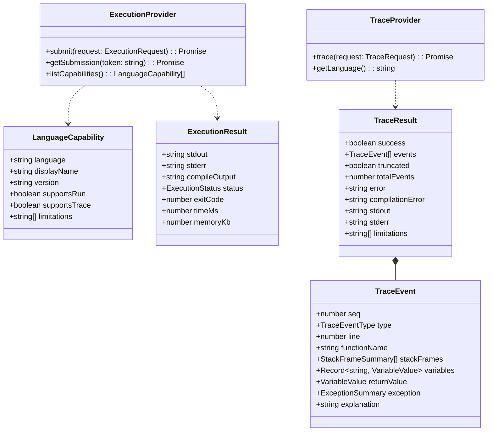

# AlgoLens — Multi-Language Execution and Tracing Architecture

**Version:** 1.0.0  
**Status:** Implemented & Verified  
**Audience:** Full-Stack Engineers, DevOps, System Designers, EdTech Instructors  

---

## 1. Product Requirements & Core Philosophy

AlgoLens enforces a strict tri-modal execution philosophy to ensure educational authenticity and trustworthy learning feedback:

```
┌───────────────────────────────────────────────────────────────────────────────────┐
│                                 ALGOLENS EXECUTION TRIAD                          │
├─────────────────────────┬─────────────────────────┬───────────────────────────────┤
│ 1. RUN                  │ 2. TRACE                │ 3. VISUALIZE                  │
├─────────────────────────┼─────────────────────────┼───────────────────────────────┤
│ Execute user's code     │ Inspect real execution  │ Map real trace state to       │
│ and return actual       │ events (source lines,   │ visual DSA representations    │
│ stdout, stderr, compile │ stack frames, scopes,   │ (arrays, pointer badges,      │
│ errors, and status.     │ variables, exceptions). │ call stacks, trees, tables).  │
└─────────────────────────┴─────────────────────────┴───────────────────────────────┘
```

> [!IMPORTANT]
> **Authenticity Mandate:** AlgoLens never presents a predefined, hardcoded algorithm animation as the trace of arbitrary user code. If a language does not support tracing, the system allows **Run** mode with honest compiler/runtime stdout/stderr, while explicitly communicating that **Trace** mode is not available for that language.

---

## 2. Codebase Audit & Component Reuse Strategy

An audit of the existing AlgoLens application reveals the baseline components and determines what can be reused versus what genuinely new subsystems are required:

| Existing Component | Audit Finding & Current Capability | Strategy & Integration Path |
|---|---|---|
| **Frontend Execution Store & Playback Controller** (`useExecutionController.ts`, `stepBuilder.ts`) | Supports forward/backward stepping, pause, play, speed adjustments, and state snapshots. | **Reused.** The internal `ExecutionStep` schema is adapted to consume normalized `TraceEvent` objects from backend debugger providers. |
| **Monaco Code Editor Panel** (`CodeEditorPanel.tsx`) | Supports line highlighting (`deltaDecorations`), multi-language tabs (TS, Java, Python, C++), and resilient line fallbacks. | **Reused.** Dynamically receives line numbers from the active `TraceEvent` to highlight executed lines in real time. |
| **State Inspection Panels** (`VariablesPanel.tsx`, `CallStackPanel.tsx`) | Displays variable key-value pairs and call stack frames. | **Reused.** Displays real debugger stack frames and typed variable state captured by the runtime tracer. |
| **Array & Grid Visualizers** (`ArrayVisualizer.tsx`, `VisualizerRouter.tsx`) | Renders animated elements with pointer badges (`L`, `R`, `mid`, `i`, `j`), comparison highlights, and values. | **Reused.** A trace-to-visualization adapter maps raw variable names (e.g. `low`, `high`, `nums`) to visual roles. |
| **Custom Code Web Worker** (`customCodeWorker.ts`, `customCodeRunner.ts`) | Pure client-side JavaScript sandbox with simulated tracer API. | **Preserved for client JS.** Remains available as an instant client-side JS playground, while multi-language Run and Trace route through the backend. |
| **Backend Express Server** (`server.ts`, `app.ts`) | OWASP headers, rate-limiting, SQLite database, user authentication. | **Extended.** Houses backend-only execution adapters (`/api/execution/run`, `/api/execution/trace`, `/api/execution/languages`), keeping all execution provider keys and sandbox orchestration secure. |

---

## 3. Shared Data Contracts (Phase 2)

All multi-language execution and tracing modules adhere to strongly typed, language-agnostic contracts:



### Safety and Serialization Limits
To prevent denial-of-service through deeply nested, circular, or excessively large user structures:
- **Max Trace Events:** Capped at 500 events per execution by default.
- **Max Collection Elements:** Arrays and collections are serialized up to 50 elements. Truncation flags indicate omission of remaining elements.
- **Max Object Depth:** Object property recursion is strictly capped at depth 3.
- **String Length Capping:** String representations are truncated at 256 characters.
- **Cyclic Reference Detection:** An identity set (`Set<Object>`) tracks visited object references to break cycles cleanly without stack overflows.

---

## 4. Multi-Language Run Architecture (Phase 3)

The Run mode delegates execution to a Judge0-compatible execution provider through an asynchronous backend adapter:

```
[Student Frontend]
        │
        ▼ (POST /api/execution/run)
[AlgoLens Express API]
   ├─► [Rate Limiter & Input Validator] (Payload size <= 64KB, timeout <= 10s)
   ├─► [Language Allowlist] (java, python, cpp, javascript)
   └─► [Execution Adapter]
            │
            ├─► [Judge0 Execution Provider (Async)]
            │        │ POST /submissions?base64_encoded=true&wait=false
            │        │ GET  /submissions/:token (Polling with exponential backoff)
            │        └─► Returns ExecutionResult (stdout, stderr, compile_output, status)
            │
            └─► [Mock / Local Fallback Provider]
                     └─► Used during offline tests & CI test gates without network
```

### Security & Operational Rules for Run Mode:
1. **Credentials Isolation:** Provider API keys (`X-RapidAPI-Key` or `X-Auth-Token`) are stored exclusively in backend environment variables and are never transmitted to the client.
2. **Strict Server-Side Allowlist:** Only verified language IDs are accepted (e.g., Java 15+, Python 3.10+, C++ GCC 11+, Node.js 18+). Client-supplied runtime IDs are validated against server configuration.
3. **No Code Persistence:** User source code sent for execution is processed ephemerally in memory and is not stored in the application SQLite database.
4. **Timeout & Resource Clamping:** Maximum CPU time is clamped to 5 seconds; wall-clock polling times out after 10 seconds.

---

## 5. Real Java Tracing Engine (Phase 4)

Real Java tracing is implemented using the standard **Java Debug Interface (JDI)** via the OpenJDK `jdk.jdi` module.

### Architectural Decision: Why JDI?
- **Zero Third-Party Dependencies:** JDI is a built-in standard module in OpenJDK (`jdk.jdi`), meaning no external commercial dependencies or licensing risks.
- **True Source-Level Debugging:** JDI inspects real JVM execution threads, stack frames, local variables, object fields, and uncaught exceptions without modifying or corrupting user bytecode.
- **Process Isolation:** The tracer runs as an independent external JVM process (`java -cp ... com.algolens.tracer.JavaTracer`), completely decoupled from the Node.js Express process.

### Tracing Pipeline:
1. **Source Packaging:** The user's Java code is written to an ephemeral, isolated directory (`scratch/java-trace-<uuid>/`). If the code lacks a `class` wrapper, a template provides `public class Solution { public static void main(String[] args) { ... } }`.
2. **Compilation with Debug Symbols:** `javac -g -d <sandbox> Solution.java` generates full LineNumberTable and LocalVariableTable attributes in the bytecode.
3. **JDI Launching:** The Java tracer connector launches the target JVM with JDWP debugging enabled:
   `com.sun.jdi.CommandLineLaunch` with options: `-cp <sandbox> Solution`.
4. **Event Observation:**
   - Filters events to classes within user namespace (ignoring JDK internal classes like `java.lang.ClassLoader`).
   - Registers a `StepRequest(STEP_LINE, STEP_INTO)` on the main thread.
   - Listens for `MethodEntryEvent`, `MethodExitEvent`, `LocatableEvent`, `ExceptionEvent`, and `VMDeathEvent`.
5. **State Extraction:** On every line step:
   - Captures current line number and method name.
   - Inspects active stack frames (`thread.frames()`).
   - Inspects visible local variables (`frame.visibleVariables()`) and values (`frame.getValue()`).
   - Serializes primitive values, strings, array elements, and object properties with cycle and depth limits.
6. **Normalization:** Formats state into the standardized `TraceEvent` JSON stream and flushes to stdout.

---

## 6. Visualization & Playback Adapter (Phase 5)

When a `TraceResult` returns from the Java tracer, the frontend adapter transforms the raw debugger events into AlgoLens's reactive visualization model:

```
[Java Trace Result] 
        │
        ▼
[Frontend Trace Adapter]
   ├─► Line Number -> Monaco Editor Line Highlight (`deltaDecorations`)
   ├─► Stack Frames -> Call Stack Panel (`CallStackPanel.tsx`)
   ├─► Scope Variables -> Variable Diff Panel (`VariablesPanel.tsx`)
   └─► Collection & Pointers -> Array Visualizer (`ArrayVisualizer.tsx`)
            ├─ Automatically detects array variables (e.g. `int[] arr`, `int[] nums`)
            └─ Automatically binds index variables (`low`, `mid`, `high`, `i`, `j`) as pointer badges
```

Learners can also manually override variable-to-pointer bindings using an interactive role mapping dropdown if variable naming is ambiguous.

---

## 7. Future Trace Adapters (Phase 6 Roadmap)

The modular `TraceProvider` interface allows subsequent trace backends to be slotted in without modifying the frontend:

1. **Python Tracing (`sys.settrace` / `bdb`):**
   - Python script wrapper invoking `sys.settrace()` to intercept `call`, `line`, `return`, and `exception` events.
   - Uses `inspect.currentframe()` to serialize `f_locals` and stack depth.
2. **C/C++ Tracing (GDB/MI / LLDB-DAP):**
   - GDB Machine Interface (`gdb --interpreter=mi2`) executing in a headless Linux container.
   - Steps via `-exec-step`, capturing `-stack-list-frames` and `-stack-list-variables`.

---

## 8. Security & Sandbox Boundary (Phase 7)

Executing untrusted code requires multiple layers of defense:

1. **Process Separation:** Neither user code nor compilation runs within the Express HTTP process.
2. **Ephemeral File Isolation:** Each trace job uses a unique directory under `scratch/` with restricted permissions, deleted immediately upon job completion.
3. **Execution Timeouts:** Hard timeout of 6 seconds enforced by Node.js child process process kill (`SIGKILL`).
4. **Non-Root Execution in Containers:** In production Docker and Kubernetes deployments, workers execute with `runAsNonRoot: true`, `readOnlyRootFilesystem: true` (with mounted `/tmp`), and all Linux capabilities dropped (`drop: [ALL]`).
5. **No Docker Socket Access:** The backend API has zero access to the host Docker daemon socket.
